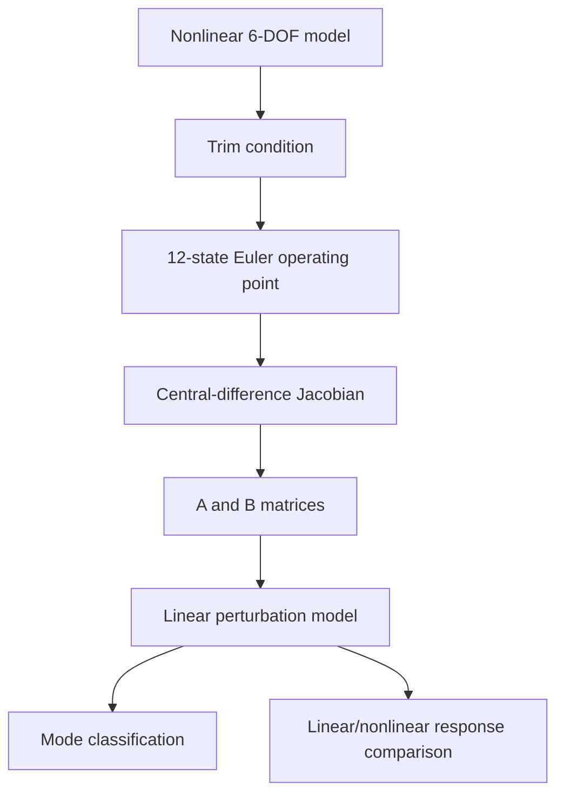

# Canonical Simulator Architecture

The repository is organized around four active areas:

1. **src/aircraft6dof/** — the canonical simulator implementation. New physics belongs here.
2. **studies/** — reproducible engineering studies built on the canonical model.
3. **comparison/** — controlled code-to-code comparisons, including the optional JSBSim harness.
4. **tests/** — fast verification and regression tests for the physics, integration, reporting, studies, and comparisons.

main.py defines the default demonstration case. Generated CSV, JSON, plots, and animations under outputs/ are runtime artifacts, not separate simulator implementations. The JSBSim comparison is useful for implementation consistency, but it fits this repository's compact aerodynamic model to JSBSim and is not independent aircraft validation.

## Physics pipeline

```
Pilot / controller commands
        |
        v
 actuator dynamics (optional)
        |
        v
  control surface states
        |
        +-------------------------------+
        |                               |
        v                               v
 atmosphere + wind                propulsion
        |                               |
        v                               |
 relative wind                          |
        |                               |
        v                               |
 alpha, beta, V, qbar, Mach             |
        |                               |
        v                               |
 nonlinear aerodynamic model            |
        |                               |
        +---------------+---------------+
                        v
                 forces + moments
                        |
             +----------+-----------+
             |                      |
             v                      v
        gravity model        6-DOF rigid body
                                   |
                            body velocity
                            angular rates
                                   |
                     +-------------+-------------+
                     |                           |
                     v                           v
               quaternion attitude         NED position
                     |
                     v
               frame transforms
                     |
                     +------ feedback ------+
```

## Canonical state

The state is represented by:

```
N, E, D
u, v, w
p, q, r
q0, q1, q2, q3
```

That is 13 stored numbers, but only 12 physical degrees of freedom because the quaternion has a unit-norm constraint.

Quaternions are used in the canonical simulator to avoid the Euler-angle singularity that exists at pitch = ±90°.

Euler angles are still calculated for human-readable output.

## Force balance

```
m(v_dot + omega × v) = F_total
```

with

```
F_total = F_aero + F_prop + m g_body
```

## Moment balance

```
I omega_dot + omega × (I omega) = M_total
```

with

```
M_total = M_aero + M_prop
```

## Attitude

The body-to-NED quaternion obeys:

```
q_dot = 1/2 q ⊗ [0, p, q, r]
```

for the local flat-Earth convention used by the core.

## Aerodynamic model

The default generic aircraft uses coefficient buildup with:

- lift curve slope;
- elevator effectiveness;
- pitch-rate damping;
- quadratic induced/profile-drag approximation;
- side-force/sideslip terms;
- roll/yaw static and rate derivatives;
- aileron/rudder effects.

The coefficients are **generic demonstration parameters**, not the measured characteristics of a named aircraft.

For a real aircraft model, replace them with validated wind-tunnel, flight-test, DATCOM/CFD, or manufacturer data.

## Environment

The core includes:

- standard-atmosphere temperature/pressure/density/speed of sound;
- latitude/altitude normal-gravity approximation;
- steady NED wind;
- deterministic one-minus-cosine gust;
- reproducible stochastic turbulence process.

The stochastic class implements first-order longitudinal and second-order lateral/vertical Dryden spectral shapes. It uses exact discrete-time state transitions and integrated process-noise covariance for each fixed-airspeed step, with configured sigma values representing stationary RMS intensities. It is not a complete MIL-F-8785C implementation: severity/altitude parameter selection, angular turbulence, and independent spectral conformance testing are outside the current scope.

## Time-dependent inputs and integration

The RK4 state integrator accepts stage-time-aware derivative callbacks. In the
canonical simulator, time-dependent deterministic controls and environment
callbacks are sampled at the RK4 stage times instead of sampling the environment
once and holding it through the complete step.

- Without an `ActuatorSet`, aileron, elevator, rudder, and throttle callbacks
  are evaluated at each RK4 stage.
- With an `ActuatorSet`, each surface actuator is advanced once at the interval
  boundary and its deflection is held over that aircraft step. Throttle is
  evaluated at each RK4 stage because it is not part of the surface actuator
  model.
- Piecewise-constant commands should change on integration-grid boundaries.
  The step endpoint is treated as the left limit for integration, and the next
  interval samples the new command. Refine the timestep or split the step at
  known discontinuities that do not lie on the grid.
- `DrydenTurbulence.step()` is a discrete stochastic state update, not a pure
  function of time. Advance it once per chosen turbulence interval and hold the
  returned sample for the RK4 stages; do not call `step()` from an environment
  callback that the RK4 integrator invokes four times per aircraft interval.

The default `main.py` case uses a deterministic one-minus-cosine gust and does
not instantiate `DrydenTurbulence`. Smooth-input timestep convergence remains
the appropriate check for whether a selected step is small enough for a chosen
response metric.

## Operating points, local linearization and modes

The canonical path from nonlinear simulation to local flight-dynamics analysis is:



`equations.py` separates the rigid-body equations into `rigid_body_derivative()`.
`state_derivative()` remains the canonical assembly point for aerodynamics,
propulsion, relative air velocity and gravity, then delegates propagation to
that function. This makes translational, rotational and quaternion equations
directly testable without duplicating force/moment assembly.

`linearize.py` evaluates the existing nonlinear derivative through a 12-state
Euler wrapper and builds local state and control Jacobians. `modes.py` classifies
eigenvalues of the longitudinal and lateral-directional subsystem matrices.
These modes describe local behavior near the selected operating point; they do
not establish that generic parameters match a physical aircraft.

## Fidelity boundary

This is a real nonlinear 6-DOF **flight-dynamics framework**, not a flight-certified or aircraft-validated model.

High-fidelity results require aircraft-specific:

- geometry;
- mass properties;
- aerodynamic coefficient data;
- propulsive maps;
- actuator characteristics;
- sensor models;
- engine dynamics;
- landing-gear/contact models;
- validated turbulence parameters;
- appropriate Earth/atmosphere model for the mission.

The software architecture is designed so those models can be inserted without rewriting the rigid-body integrator.
